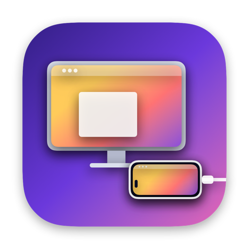
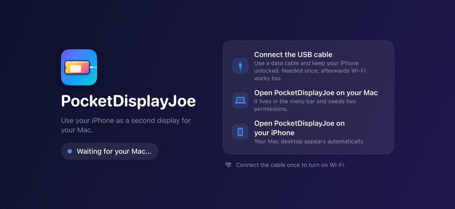
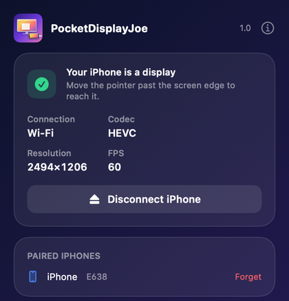

# PocketDisplayJoe

<p align="center">
  
</p>

<h3 align="center">PocketDisplayJoe</h3>

<p align="center">
  <b>Use your iPhone as a second display for your Mac — over USB or Wi-Fi, with touch as mouse. Native Swift &amp; SwiftUI.</b>
</p>

<p align="center">
  
  
  
  
  
  <a href="https://github.com/joemockdao/PocketDisplayJoe/stargazers">
    
  </a>
</p>

---

PocketDisplayJoe turns an iPhone into an extra monitor for your MacBook or Mac mini. Touch works as a mouse: one finger clicks and drags, two fingers scroll.

<p align="center">
  
  
</p>

## 🚀 Key Features

- **Real second display** – a virtual monitor sized to your iPhone's screen (HiDPI, 60 fps), so you can drag windows onto it.
- **Hardware video pipeline** – ScreenCaptureKit → VideoToolbox (HEVC, with automatic H.264 fallback) → hardware decoding on the iPhone.
- **USB or Wi-Fi** – the cable needs no setup; Wi-Fi is encrypted (TLS with a pre-shared key) and works only with devices you paired.
- **Private by design** – no accounts, no cloud, no analytics. Everything stays between your two devices.
- **Native and small** – Swift/SwiftUI only, no third-party dependencies (~2,500 lines).
- Menu bar app on the Mac with one-click **Disconnect / Reconnect**, launch at login, and a UI in English, Italian, French, Spanish and German.

> PocketDisplayJoe is a personal project, shared as-is. It uses a **private macOS API** (see *Limitations* below), so it is meant to be built from source and is not distributed through the App Store.

## 🛠️ Requirements

| | |
|---|---|
| Mac | macOS 14 or later (developed on macOS 27 with Xcode 27.1, Apple Silicon) |
| iPhone | iOS 17 or later, landscape only |
| Build tools | Xcode, [XcodeGen](https://github.com/yonaskolb/XcodeGen) (`brew install xcodegen`) |
| Signing | A free Apple ID is enough (Xcode → Settings → Accounts) |

## 📦 Build and Run

```sh
git clone https://github.com/joemockdao/PocketDisplayJoe.git
cd PocketDisplayJoe

# Your Apple Team ID and a unique bundle identifier prefix (this file is git-ignored):
cp Config/Local.xcconfig.example Config/Local.xcconfig
open -e Config/Local.xcconfig

xcodegen generate
open PocketDisplayJoe.xcodeproj
```

1. Select the **PocketDisplayJoePhone** scheme, choose your iPhone and run. On the iPhone, trust your developer certificate (Settings → General → VPN & Device Management). With a free Apple ID the app must be re-installed every 7 days.
2. Select the **PocketDisplayJoeMac** scheme and run. The app lives in the menu bar and asks for two permissions: **Screen Recording** (to capture the virtual display) and **Accessibility** (to turn touches into mouse events).
3. Plug the iPhone in with a data cable, keep it unlocked and open PocketDisplayJoe on it. Its screen appears as a new display in *System Settings → Displays*; move the pointer past the screen edge to reach it.

### 📡 Using Wi-Fi

The first connection must be made **with the cable**: the Mac sends the iPhone a random secret key, and both store it in the Keychain. After that you can unplug: with PocketDisplayJoe open on the iPhone and both devices on the same network, the Mac finds the iPhone via Bonjour and connects with an encrypted channel. Allow the *Local Network* permission when macOS and iOS ask.

Paired iPhones are listed in the Mac panel (**Forget** removes one); the iPhone has a **Forget paired Macs** button. Re-connecting the cable pairs again.

## ⚙️ How It Works

```
Mac                                                         iPhone
CGVirtualDisplay ─▶ ScreenCaptureKit ─▶ VideoToolbox ──▶ AVSampleBufferDisplayLayer
 (virtual monitor)       (NV12)        (HEVC / H.264)      (hardware decoding)
        ▲                                   │ framed TCP: USB (usbmuxd) or Wi-Fi (Bonjour + TLS-PSK)
        └──── mouse events (CGEvent) ◀──────┴──────────────────────── touches
```

- **Transport:** the iPhone listens, the Mac connects. Over USB the Mac talks to `usbmuxd` (the same service Xcode uses) which forwards to a loopback-only port on the iPhone. Over Wi-Fi the iPhone advertises `_pocketdisplay._tcp` and accepts only TLS 1.2 connections authenticated with the pre-shared key.
- **Pairing:** the key travels only through the cable and is accepted by the iPhone only when it arrives over the cable.
- **Low latency:** no B-frames, frames are dropped *before* encoding when the link is congested, and the Wi-Fi path adds a small 50 ms playout buffer driven by capture timestamps to absorb radio jitter (the cable path has none).
- **Wire protocol:** length-prefixed binary messages (`Shared/Wire.swift`).

## 🗂️ Project Layout

| Path | Contents |
|---|---|
| `Shared/` | Wire protocol, `Link` (network framing, TLS-PSK), pairing/Keychain, shared SwiftUI components, localization catalog |
| `Mac/` | Virtual display, capture, encoder, usbmuxd client, Bonjour, input injection, menu bar UI |
| `Phone/` | Listeners, video sink (decoder/renderer), touch handling, UI |
| `Tests/` | Swift Testing: protocol, pairing, localization completeness |
| `Tools/` | `fakephone` (fake iPhone for end-to-end tests), `icongen` (regenerates the app icons) |
| `Config/` | Build settings; `Local.xcconfig` holds your personal values |

Run the tests with `xcodebuild -project PocketDisplayJoe.xcodeproj -scheme PocketDisplayJoeMac -destination 'platform=macOS' test`. Code comments are in Italian.

## ✅ Tested With

- MacBook Pro (Apple Silicon), macOS 27.0, Xcode 27.1
- iPhone 11 (physical device) over USB and Wi-Fi; iPhone 17 Pro Max simulator
- Wi-Fi: 5 GHz network, ~56 fps delivered with 1–3 % of frames arriving later than the 50 ms buffer

Not tested: Intel Macs (the H.264 fallback exists for Macs without a hardware HEVC encoder but has only been exercised by forcing it), several iPhones at once, other iPhone models, other networks.

## ⚠️ Limitations

- **Private API.** The virtual display uses `CGVirtualDisplay`, an undocumented CoreGraphics API. It works today but a macOS update may break it, and it makes the Mac app unsuitable for the App Store.
- The Mac app is not sandboxed (needed for input injection and `usbmuxd`).
- The first Wi-Fi pairing requires the cable; there is no QR/code pairing.
- Wi-Fi uses TLS 1.2 with a pre-shared key: authenticated and encrypted, but without forward secrecy. The USB channel is not encrypted (it is point-to-point).
- The iPhone app must stay in the foreground; iOS suspends it when the screen locks.
- Wi-Fi adds ~50 ms of video latency compared to the cable. Landscape and dark theme only.

## 🩺 Troubleshooting

- **"Update the iPhone app"** in the Mac panel: the iPhone runs a different version of PocketDisplayJoe; install the latest build on both.
- **The Mac connects but nothing appears:** check *Screen Recording* in System Settings → Privacy & Security, then restart the Mac app.
- **No Wi-Fi connection:** both devices need the Local Network permission and the same network; guest/isolated Wi-Fi networks block device discovery. Re-connect the cable once to repair the pairing.

## 📬 Feedback & Support

Found a bug or have an idea? [Open an issue](https://github.com/joemockdao/PocketDisplayJoe/issues).

### Other Apps by the Developer
Check out my other projects on the App Store and beyond:
* 🛌 [SleepRec](https://apps.apple.com/it/app/sleeprec/id1528754113) ([Google Play](https://play.google.com/store/apps/details?id=it.joe.sleeprec)) — Night-time audio analysis and sleep statistics.
* 📝 [JoeNote](https://apps.apple.com/it/app/joenote/id6738133424) ([Google Play](https://play.google.com/store/apps/details?id=it.note.joeNote)) — Notes, checklists and reminders.
* 📸 [ScreenShotJoe](https://github.com/joemockdao/ScreenShotJoe) — Store screenshots with mockups in 12 languages.
* 🎬 [Klipzen](https://github.com/joemockdao/Klipzen) — macOS video editing app.
* 🧹 [CleanMacJoe](https://github.com/joemockdao/CleanMacJoe) — macOS disk cleaner & app uninstaller.
* 🔗 [Linktree](https://linktr.ee/joemockdevmobile) — All my projects in one place.

## 📄 License

[MIT](LICENSE) © 2026 Giovanni Trenta
